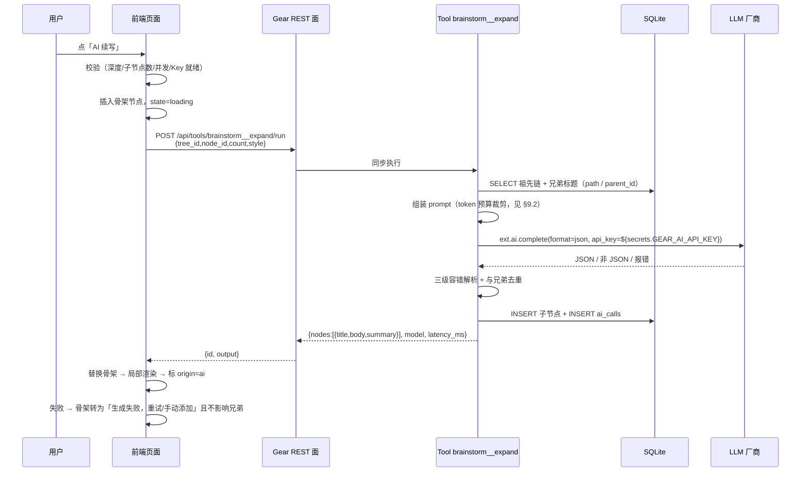

# 头脑风暴 App 需求说明 v1（思维导图版）

> 目标：把现有的卡片式头脑风暴（`apps/brainstorm/www/index.html` + `DESIGN.md`，2026-09-22 已实证跑通）
> 升级为**无限层级的树状思维导图**：节点可逐级展开、可触发 AI 续写自动生成下级、
> 平时只显示短标题、双击以 Markdown 渲染详情、支持增删改，并补上**持久化**与**分类**。
>
> 本文所有技术约束都对齐 Gear 当前内核（`ext.ai` / `db` / `static_site.serve` / REST 面），
> 不假设框架尚不存在的原语。框架侧缺口在 §11 单列。

---

## 1. 定位、用户与范围

| 项 | 内容 |
|---|---|
| 一句话定位 | 单人、本机、以 AI 续写为驱动的想法孵化工具；**Finder 风格三栏布局** |
| 主用户 | 东东本人（单机使用，不面向多人） |
| 运行形态 | Gear App：`static_site.serve` 托管静态页 + `/api` 前缀反代到 Gear REST 面（同源，无跨域） |
| 数据来源 | 人工输入 + `ext.ai.complete`（BYOK，Key 归用户） |
| 生命周期 | 长会话：一次头脑风暴可跨天继续，树可归档、可回溯 |

### 1.1 与 v1 的差异（这是重写，不是补丁）

| 维度 | v1（现状） | v2（本文目标） |
|---|---|---|
| 结构 | 平铺卡片 + 一层「深化」子项 | 任意深度树 |
| 层级上限 | 2 层 | **不设硬上限**（深度护栏见 §9.3，仅作 AI 续写成本提醒，不禁止手工加深） |
| 详情 | 卡片上直接铺 `desc` | **Finder 三栏**：左栏分类/树列表，中栏节点层级（列视图逐级向右钻），右栏固定渲染选中节点的 Markdown 内容 |
| 持久化 | 无（刷新即丢，仅 Key 存 localStorage） | SQLite 落盘，自动保存 |
| 分类 | 无（单会话） | 多棵树 + 分类 + 标签 |
| AI 调用 | 前端裸调 `/api/capabilities/invoke`，Key 在前端 | 封装为 Tool 走 `/api/tools/{id}/run`，Key 留在服务端 |
| 删除 | 直接从数组 splice | 软删除 + Undo |

### 1.2 非目标（本期明确不做）

多人协作 / 实时同步、移动端触屏手势、完整鉴权体系、
云端存储、图片节点、节点间自由连线（本期是严格树，不是图）。

---

## 2. 功能需求

编号规则 `FR-xx`，每条附验收标准（可勾选）。

### FR-00 手工优先（核心约束）

> 这条是总纲，高于所有 AI 相关需求：**整棵树可以由用户纯手工建出来，AI 只是一个加速器，不是前提。**

- 不依赖任何 AI：无 `GEAR_AI_API_KEY`、断网、或用户不想用 AI 时，建树、扩层、编辑、删除、改详情、
  分类、搜索、导出**全部可用且体验完整**。
- 每个节点都可被用户**亲手创建与编辑**：标题内联改、详情在抽屉里改、子节点手动加。
- AI 续写产出的子节点，与手工节点**完全同构**（同一套 `MindNode`、同一套落库、同一套编辑入口），
  只是 `origin=ai`。用户可以对 AI 生成的节点继续手工删改，AI 节点与手工节点在编辑面板上无差别。
- 验收：从头到尾不点一次「AI 续写」，也能造出一棵 5 层、50 节点的树，并正常持久化。

### FR-01 树状渲染与逐级展开

- **三栏布局（见 FR-01b）**：中栏用 Finder 列视图呈现层级——点一个节点，它的子节点在**右侧新一列**展开，逐列向右钻取（这就是「逐级展开」的落点）。
- 每列内节点只显示短标题；有子节点的项右侧带 `›` 指示可继续钻取，无子节点显示为叶子。
- 支持「展开 / 折叠全部」（折叠 = 收回到根列）、「展开到第 N 级」。
- 键盘：`→` 钻入选中节点的子列 / `←` 退回父列 / `↑` `↓` 同列移动 / `Space` 在当前列收起子列。
- 验收：6 层深、200 节点的树，列切换 < 100ms；当前钻取路径与每列滚动位置刷新后保持。

### FR-01b 三栏 Finder 风格布局（核心形态）

> 整体对齐 macOS Finder 资源管理器的列视图：左栏 = 收藏/分类侧栏；中栏 = 文件夹列（这里是节点层级）；
> 最右栏 = 选中文件的预览（这里是节点 Markdown 内容）。

| 栏 | 内容 | 来源 |
|---|---|---|
| 左栏（侧栏） | 分类分组（`inbox`/`work`/`idea`/…）+ 每棵树的条目 + 标签筛选 + 搜索框 | `trees` 表 + `node_tags` |
| 中栏（层级列） | 沿「当前钻取路径」铺开的若干列；每列是某节点的子节点列表，点节点向右生成下一列 | `nodes` 表（按 `parent_id`） |
| 右栏（预览） | **始终渲染当前选中节点的 Markdown 内容**；可切「预览 / 编辑」；失焦即存 | `nodes.body` |

- 右栏是**常驻预览列**，不是弹窗/抽屉：选中即渲染，不选中时显示占位（「选一个节点看详情」）。
- 双击中栏节点 = 在右栏进入**编辑态**（而非打开弹窗）；单击 = 选中并预览。这与 Finder 的单击预览、双击打开一致。
- 中栏列数不固定：钻得越深列越多；窗口宽度不够时最左列被挤掉（保持「钻取路径」始终可见，根列可滚动找回）。
- 验收：左栏切分类 → 中栏换树；中栏双击节点 → 右栏进入编辑；刷新后三栏状态一致。

### FR-02 节点 AI 续写

- 任意节点（含根）可触发「AI 续写」，生成 N 个**子节点**并落库。
- **条数可选、默认由 AI 决定**（`count` 留空/0 = 自动）：用户本来就不该猜「分几支合适」——
  prompt 明确「按内容复杂度自然分，通常 3~9 个，不要凑数也不要遗漏显而易见的大类」；
  显式填 1~12 时才作为目标条数。自动模式仍有 `AUTO_HARD_CAP=16` 兜底（**防失控输出的护栏，不是目标值**）。
- **两种生成模式**（`mode`）：
  - `append`（默认）：补充不重复的新子节点；
  - `regroup`：**重新规划整体划分**——把已有全部子项（含 summary）交给 AI，要求给出**完整的新方案**，
    复用已有项（标题相同则不重复创建、不覆盖已编辑内容）、补齐缺失的大类、合并过细项。
    落库策略 **只增不删**：AI 新方案里没提到的现有项作为 `extras` 只报不删（删节点是破坏性操作，由人决定）。
- **为什么需要 `regroup`（2026-09-23 东东提出）**：只反复点 `append` 会**越点越差** ——
  每轮 prompt 都带「已有项，不要重复」，于是第一轮拿走大类，之后几轮只能去挑**边角料**，
  最终是多轮打补丁拼凑的产物，而非一次规划好的体系。`regroup` 让 AI 每次都**看到全局重新规划**，
  产出是体系内的补充。实测（真实 AI）：已有 14 项时 `kept=9 / created=3`（补出「特殊句型结构」
  「语法功能分类」「常见语法错误辨析」等）。
- 两种风格：`发散`（横向长出并列想法）/ `深化`（向下拆成落地动作）。
- **每个子节点由 AI 同时产出 `summary`**（一句话，~50 字内）与 `body`（2~4 句要点）：
  `summary` 是上级/相邻节点的上下文索引（§5 分层预算的核心杠杆），`body` 让读者不点开也能明白这一项的范围与例子。
- 生成中节点显示骨架 + `AI 生成中…`，可取消；生成结果带 `origin=ai` 标记。
- 验收：点击后 3s 内出现加载态；成功/失败都有明确终态；失败不影响已有节点。

### FR-02b 节点 AI 展开（写**本节点自己**的摘要 / 正文）

- 选中任意节点可触发「AI 展开本节点」：AI 为该节点**自己**写 `summary`（一句话）与 `body`（Markdown 正文）并落库。
- **与 FR-02 的分工**：FR-02 长出**子节点**（并列/下钻）；FR-02b 把**当前这一节讲清楚**。
  两者共用同一个「AI 要求」输入框——那里的文字是**受众 / 角度 / 详略**限定，对两个按钮都生效。
- 典型场景：AI 建完整棵轮廓后，用户挑一个节点说「把这一节讲清楚」；或给已有节点补内容。
- 验收：产出须含 Markdown 结构（小标题 / 列表 / 例子），不得复述标题、不得写「本节点将…」这类元话术；
  落库后阅读模式立即渲染出效果。
- 实现：Tool `mindstorm__enrich`（`capabilities:[db, ext.ai]`，`timeout:"5m"` —— 同步调 AI 必须覆盖引擎默认
  30s 闸门，见 `REQ-TOOL-TIMEOUT`/#77）。返回结构按「数组包一层 / `data|result|output` 包装 / 字段别名
  `content|markdown|text`」三重容错，否则真实模型换个包装就取不到字段。
- **增补背景（2026-09-23 实测反馈）**：首版只有 FR-02，东东把「我是一个英语初学者，请帮我详细介绍小学英语语法」
  填进「续写要求」，却只能得到 12 个并列的子节点标题（教科书目录），**因为那个框的产出天生只是子节点列表**，
  再好的措辞也变不出正文。补上本 FR 后，同一句话交给 enrich，产出带小标题、例句与正误对照的正文，才符合预期。
  —— 教训：**用户「问不好」往往是因为对应的入口不存在**，不能只归因于提示词。

### FR-03 节点标题 / Markdown 详情分离（右栏常驻预览）

- 中栏节点行**只显示短标题**（超长截断 + `title` 属性兜底）。
- **单击节点** → 右栏（常驻预览列）以 Markdown 渲染 `body`；**双击节点** → 右栏进入**编辑态**（源码 / 预览切换）。
- 右栏编辑失焦即存（防抖 800ms）；不选中任何节点时右栏显示占位提示。
- 验收：Markdown 支持标题、列表、代码块、引用、加粗、链接；不渲染内联 HTML（安全，见 §6.4）。
- 验收：双击中栏节点，右栏立即从预览切到编辑，焦点进编辑器；`Esc` 退回预览。

### FR-04 节点增删改

| 操作 | 入口 | 约束 |
|---|---|---|
| 增（同级） | `Enter` / 节点菜单 | 在当前节点**之后**插入 |
| 增（子节点） | `Tab` / 节点菜单 | 深度 +1，**无硬上限**（仅 AI 续写在深层级给二次确认，见 §9.3-3） |
| 改标题 | `F2` 或双击标题区（区别于双击行 = 开详情） | ≤ 40 字 |
| 改详情 | 详情面板 | ≤ 4000 字 |
| 移动 | 拖拽 / `Alt+↑↓` | 只允许在树内移动，**禁止拖到自己的子孙下** |
| 删 | `Delete` / 菜单 | 软删除 + 级联子孙 + 5s Undo |
| 复制子树 | 菜单（P2） | 深拷贝，重生成 id |

- 验收：删除后 Undo 可完整恢复子树及其层级、顺序。
- **手工编辑不依赖 AI（重申 FR-00）**：双击标题区即进入内联编辑，直接敲文字即可，无需经过任何 AI 步骤；
  详情抽屉打开后默认就是可编辑态（源码/预览切换），失焦即存。手工节点与 AI 节点用同一套编辑入口。

### FR-05 持久化

- 所有结构变更自动落盘，**刷新 / 重启应用不丢**。
- 顶部常驻保存指示：`已保存 / 保存中… / 保存失败（重试）`。
- 写失败时前端保留内存副本并明确告警，**绝不静默丢弃**。
- 验收：kill 掉应用再拉起，树结构、详情、折叠状态、分类全部一致。

### FR-06 分类

- 一棵树（Tree）= 一次头脑风暴画布，带 `category` 字段。
- 侧栏按分类分组列出所有树；可新建 / 重命名 / 改分类 / 归档 / 删除。
- 节点级标签 `tags`（如 `#idea` `#risk` `#action` `#done`），顶栏可按标签筛选高亮。
- 验收：分类切换后 URL 带 `?tree=<id>`，可直接分享/刷新定位。

### FR-07 搜索

- 对当前树（默认）或全部树（开关）做标题 + 详情全文匹配。
- 命中节点自动展开其祖先链并高亮；`Enter` 循环跳转。
- 验收：依赖索引（`title`/`path` 上的 SQLite 索引），万级节点下搜索响应 < 300ms（SQLite `LIKE`，不做分词器）。节点数无硬上限，性能由索引与虚拟渲染保证，不靠计数封顶。

### FR-08 导入导出

- 导出：Markdown（按缩进层级）、JSON（完整，可回灌）。
- 导入：JSON 覆盖/合并当前树，导入前给出冲突提示。
- 验收：导出再导入，节点数、层级、详情字节级一致。

### FR-09 AI 调用可观测

- 每次 AI 调用落 `ai_calls` 表（节点、模型、耗时、prompt 摘要、原始返回）。
- 页面保留最近一帧调用明细（延续 v1 的「过程可见」原则）。
- 验收：任意一次失败可在 UI 上看到厂商返回原文。

### FR-10 无 Key 可降级

- 未配置 `GEAR_AI_API_KEY` 时：AI 按钮禁用并给出 `how_to_fix`，但**全树手工操作完全可用**。
- 提供演示数据一键载入。

---

## 3. 数据结构

### 3.1 前端运行时模型（TypeScript 口径）

```ts
type Origin = 'human' | 'ai';
type NodeState = 'idle' | 'loading' | 'error';

interface MindNode {
  id: string;             // ULID，全局唯一
  treeId: string;         // 所属树
  parentId: string | null;// 根为 null
  title: string;          // ≤ 40 字，UI 强截，落库前服务端再截一次
  body: string;           // Markdown 详情，≤ 4000 字
  summary: string;        // ≤ 120 字，供 AI 上下文使用（见 §9.2），不入 UI
  tags: string[];         // 节点标签
  origin: Origin;         // 来源，UI 用不同角标区分
  state: NodeState;       // 仅运行时，不落库
  depth: number;          // 冗余：根 = 0
  path: string;           // 物化路径 "/<rootId>/<aId>/<bId>"，祖先查询用
  order: number;          // 同级排序，步长 1000（间隙法，插入免重排）
  childCount: number;     // 冗余：驱动「是否有展开箭头」
  collapsed: boolean;     // 折叠状态（持久化，见 §7.4）
  createdAt: string;      // ISO8601
  updatedAt: string;
  deletedAt: string | null;
}

interface Tree {
  id: string;
  title: string;          // 主题
  category: string;       // 分类（见 §8）
  lens: string;           // 视角约束，随树常驻进 prompt
  model: string;          // 该树锁定的模型（空 = 用全局默认）
  temperature: number;    // 发散阶段默认 0.9
  createdAt: string;
  updatedAt: string;
}
```

**字段设计理由**

- `path`：取祖先链是 AI 上下文组装的**最高频操作**。物化路径 + `LIKE 'prefix%'` 一次查询拿全链，
  避免递归 CTE（SQLite 递归在深树上不便宜）。
- `order` 步长 1000：插入时取 `(prev+next)/2`，只有间隙耗尽才重排，避免整层 `UPDATE`。
- `summary`：AI 续写时**不能**把整棵树灌进 prompt（§9.2），`summary` 是裁剪单位。
- `depth` / `childCount`：冗余但换取渲染期零查询。

### 3.2 落库 schema（SQLite）

```sql
PRAGMA journal_mode = WAL;
PRAGMA foreign_keys = ON;

CREATE TABLE IF NOT EXISTS trees (
  id           TEXT PRIMARY KEY,
  title        TEXT NOT NULL,
  category     TEXT NOT NULL DEFAULT 'inbox',
  lens         TEXT NOT NULL DEFAULT '',
  model        TEXT NOT NULL DEFAULT '',
  temperature  REAL NOT NULL DEFAULT 0.9,
  created_at   TEXT NOT NULL,
  updated_at   TEXT NOT NULL
);
CREATE INDEX IF NOT EXISTS idx_trees_category ON trees(category, updated_at DESC);

CREATE TABLE IF NOT EXISTS nodes (
  id          TEXT PRIMARY KEY,
  tree_id     TEXT NOT NULL REFERENCES trees(id) ON DELETE CASCADE,
  parent_id   TEXT,
  title       TEXT NOT NULL,
  body        TEXT NOT NULL DEFAULT '',
  summary     TEXT NOT NULL DEFAULT '',
  origin      TEXT NOT NULL DEFAULT 'human',   -- human | ai
  depth       INTEGER NOT NULL DEFAULT 0,
  path        TEXT NOT NULL DEFAULT '',
  ord         INTEGER NOT NULL DEFAULT 0,
  child_count INTEGER NOT NULL DEFAULT 0,
  collapsed   INTEGER NOT NULL DEFAULT 0,
  created_at  TEXT NOT NULL,
  updated_at  TEXT NOT NULL,
  deleted_at  TEXT
);
CREATE INDEX IF NOT EXISTS idx_nodes_tree   ON nodes(tree_id, deleted_at);
CREATE INDEX IF NOT EXISTS idx_nodes_parent ON nodes(parent_id, ord);
CREATE INDEX IF NOT EXISTS idx_nodes_path   ON nodes(path);

CREATE TABLE IF NOT EXISTS node_tags (
  node_id TEXT NOT NULL,
  tag     TEXT NOT NULL,
  PRIMARY KEY (node_id, tag)
);
CREATE INDEX IF NOT EXISTS idx_tags_tag ON node_tags(tag);

CREATE TABLE IF NOT EXISTS ai_calls (
  id          TEXT PRIMARY KEY,
  tree_id     TEXT NOT NULL,
  node_id     TEXT,
  kind        TEXT NOT NULL,              -- diverge | deepen | cluster | summary
  model       TEXT NOT NULL DEFAULT '',
  prompt_hash TEXT NOT NULL,
  prompt_text TEXT NOT NULL,              -- 截断存 4000 字，用于复盘
  raw_text    TEXT NOT NULL DEFAULT '',
  ok          INTEGER NOT NULL DEFAULT 0,
  error       TEXT NOT NULL DEFAULT '',
  latency_ms  INTEGER NOT NULL DEFAULT 0,
  created_at  TEXT NOT NULL
);
CREATE INDEX IF NOT EXISTS idx_calls_node ON ai_calls(node_id, created_at DESC);
```

> `ord` 而非 `order`（`order` 是 SQL 保留字）。`deleted_at` 软删，30 天回收站（P2 可做硬清）。

### 3.3 交换格式（导出 / 导入）

```json
{
  "format": "gear.mindmap.v1",
  "exportedAt": "2026-09-23T08:00:00+08:00",
  "trees": [{ "...Tree 字段": null }],
  "nodes": [{ "...MindNode 字段": null }],
  "tags":  [{ "node_id": "01J...", "tag": "#action" }]
}
```

导入策略：`id` 冲突时默认**新建副本**（生成新 id 并重挂路径），而不是覆盖——避免一次误导入毁掉现有树。

---

## 4. 交互流程

### 4.1 首屏加载与恢复

```
浏览器 GET /                      → 静态页（ext.serve 托管）
  1. GET  /api/healthz            → 反代通 + flows/tools 计数（连通性自检）
  2. 读 localStorage: lastTreeId  → 无则跳 4
  3. 加载该树全部节点（一次查询，非懒加载：v1 单机规模下全量更省心，见 §9.3）
  4. 建索引（Map<id, node> + childrenOf）→ 按 collapsed 渲染 → 恢复滚动位置
  5. 顶栏显示「已保存」
```

### 4.2 折叠 / 展开

```
点箭头 ──► 有子节点？ ── 是 ──► 切换 collapsed → 写库（防抖 800ms）→ 局部重渲染
                │
                └─ 否 ──► 不显示箭头（childCount=0）
```

### 4.3 导航与详情（Finder 列视图）

```
单击 中栏节点
  ├─ 命中标题文字 → 选中 + 右栏渲染 Markdown 预览
  └─ 命中节点其他区域 → 同样选中（整行可点）
  → 若它有子节点：右侧生成「下一列」展示其子节点（逐级向右钻 = 逐级展开）
双击 中栏节点 → 右栏从预览切到「编辑态」（源码/预览切换），焦点进编辑器
  └─ 仅当双击的是标题文字且处于重命名态 → 进入标题内联编辑（见 FR-04）
右栏编辑 → 失焦即存（防抖 800ms）
← / → → 退回父列 / 钻入子列；↑ ↓ → 同列移动；Space → 当前列收起子列
Esc → 右栏从编辑退回预览
```

> **与抽屉式详情的区别**：详情是**常驻右列**，随选中节点联动，不是点了才弹出的模态/抽屉。
> 这样浏览树时右栏始终显示「当前在看什么」，符合 Finder 预览心智。双击进编辑、Esc 退回预览。

### 4.4 AI 续写（核心链路）



**关键点**

- 骨架节点先落 UI，避免「点了没反应」。
- 落库与生成的关系见 §5.5：同步路径（走 Tool）落库在服务端；流式路径（走 SSE）先在前端实时渲染、结束后再落库。
- 前端不负责拼 SQL、不拿 prompt——prompt 工程收在 Tool / 前端 `prompt` 模块里；**Key 不下前端**（见 §5.5.2）。
- 流式已支持：见 §5.5。本图是**同步路径**时序；流式路径把「T→L 整段」换成 SSE 增量，落库挪到 `done` 之后。

### 4.5 增 / 改 / 删

```
增：定位锚点 → 计算 ord=(prev+next)/2 → 本地插入 → 乐观渲染 → 写库 → 失败回滚+提示
改：编辑 → 本地改 → 防抖写库 → updatedAt 变化
删：软删（deleted_at）+ 级联子孙 → 从渲染树摘除 → Toast「已删除 · 撤销」5s
    └─ Undo：清 deleted_at（同事务级联）；超时后进入回收站
移动：校验「不能拖到自己的子孙下」→ 重算 path/depth（整棵子树 UPDATE）→ 重排 ord
```

### 4.6 分类切换

```
侧栏点分类/树 → URL ?tree=<id> → 卸载当前树（先强制写盘）→ 加载新树 → 恢复其 collapsed 状态
```

---

## 5. AI 续写触发机制

### 5.1 触发入口（四种，成本不同，UI 必须可区分）

| 入口 | 语义 | 是否调用 LLM | UI 呈现 |
|---|---|---|---|
| 折叠箭头 `▸` | 展开**已有**子节点 | 否 | 灰色箭头 |
| 「AI 续写」按钮 / `Ctrl+Enter` | **生成**新子节点 | 是 | 蓝色 + ✨ 角标 |
| 空节点自动提示 | 新建节点后引导续写 | 是（需点确认） | 虚线占位「让 AI 接着想 →」 |
| 「批量发散」（P2） | 对选中多个节点并行续写 | 是 | 需二次确认（会花 N 倍钱） |

> **红线**：三种「展开」语义不能在 UI 上长得一样。用户必须能一眼看出「这一下会不会花钱」。
> 这是 v1 最容易踩的坑（点「深化」= 花钱，但视觉上和展开没区别）。

### 5.2 服务端 Tool 契约（推荐做法）

Tool `brainstorm__expand`（Lua，`capabilities: [db, ai]`）：

```yaml
id: brainstorm__expand
kind: tool
runtime: lua
capabilities: [db, ai]
input:
  tree_id: {type: string, required: true}
  node_id: {type: string, required: true}   # 根则传 root id
  count:   {type: number, default: 5}       # 1..5
  style:   {type: string, default: diverge} # diverge | deepen
  dsn:     {type: string, default: "file:<GEAR_HOME>/brainstorm.db?_pragma=busy_timeout(5000)"}
```

输出：

```json
{
  "nodes": [{ "title": "…", "body": "…", "summary": "…" }],
  "model": "Qwen/Qwen2.5-7B-Instruct",
  "latency_ms": 4120,
  "truncated": false,
  "deduped": 1
}
```

Tool 内部职责（前端一律不参与）：

1. 查祖先链（`path LIKE`）与兄弟标题（`parent_id = ?`）；
2. 按预算裁剪组装 prompt（§9.2）；
3. `ctx.ext.ai.complete`，`api_key` 取 `${secrets.GEAR_AI_API_KEY}` / `ctx.secret.get`，**永不下发前端**；
4. 三级容错解析 + 兄弟去重；
5. `ctx.db.exec` 落子节点 + `ai_calls`；
6. 回父节点 `child_count` 自增。

> 走 Tool 而非前端裸调 `/api/capabilities/invoke`：prompt 工程可版本化、Key 不出服务端、
> 落库与生成在同一处有事务语义。这是 v1 §7.3 已列但未做的改造，本期必须做掉。

### 5.3 触发前置校验（前端，失败即短路）

| 校验 | 阈值 | 处理方式 |
|---|---|---|
| 深度 | `depth >= 8` | **软护栏**：AI 续写弹二次确认（「已较深，继续发散会加大上下文成本？」）；手工加深不受限 |
| 子节点数（AI 生成批次） | `count > EXPAND_BATCH_MAX(12)` | **硬约束（生成侧）**：单次 AI 续写最多生成 12 个子节点（成本∝N、质量随 N 断崖）；**手工添加子节点不受此限** |
| 子节点数（存储） | 无上限 | SQLite 不限制；仅当 `childCount >= 12` 时 AI 续写给「先合并同类项」软提示（不阻止） |
| 并发 | 同树已有 AI 请求在跑 | 「本树正在生成，请稍候」（入队列而非丢弃） |
| Key 就绪 | `GEAR_AI_API_KEY` 未配 | 禁用按钮 + `how_to_fix`（对齐 `gear_doctor` 的 ai 块） |
| 网络 | `/api/healthz` 不通 | 「后端未就绪」+ 重载按钮 |

### 5.4 失败与重试策略

- **重试**：仅对 超时 / 5xx / 网络错误，最多 **1 次**；`401`（Key 无效）/ `402`（余额）/ `400` **不重试**，直接给 `how_to_fix`。
- **解析容错三级**：① 严格 JSON → ② 剥掉 ```` ```json ```` 围栏再解析 → ③ 按行切分兜底。
  三级都失败：把原始 `text` 塞进父节点详情并标 `parse_error`，**不静默丢结果**。
- **取消**：前端 AbortController 只取消等待，服务端请求继续跑完并落库（结果下次进来还在）——
  在 UI 上明说「取消后结果仍会保存」，避免用户以为白花钱。
- **幂等**：`ai_calls.prompt_hash` 相同且 60s 内的重复请求，直接返回上次结果，不重复计费。

### 5.5 流式生成（2026-09-23 新增：内核已支持）

框架侧已落地流式：`ext.ai.complete_stream` + `POST /api/capabilities/invoke/stream`
（SSE，`text/event-stream`），**仅放行 `ext.ai`**，并复用 `/api/capabilities/invoke` 的
`originAllowed` 与 `secret.*` 禁调守卫（`internal/server/server.go:375-435`）。

SSE 增量帧：`{delta, reasoning}`（逐增量），结束帧 `{done:true}`，错误帧 `event:error {error}`。
`reasoning` 可能为空（非推理模型不回）。

#### 5.5.1 两条路径的取舍

| | 同步路径（走 Tool） | 流式路径（走 SSE 直调） |
|---|---|---|
| 端点 | `POST /api/tools/brainstorm__expand/run` | `POST /api/capabilities/invoke/stream`（body `{name:ext.ai, method:complete_stream, args}`） |
| 用户体验 | 点完先骨架，整段返回后一次性刷新 | **逐字流出**，节点边生成边显示，等待感最小 |
| prompt 工程 | 收在 Tool（Lua）里，可版本化 | 收在前端 `prompt` 模块（非机密，可接受） |
| 落库 | Tool 内 `db.exec`（事务内，原子） | 前端先实时渲染，**`done` 后**再调 `brainstorm__persist` Tool / `db` 落库 |
| Key | `${secrets.GEAR_AI_API_KEY}` 服务端注入 | 前端**不传** `api_key`，后端按凭据链 `env GEAR_AI_API_KEY` 自动补（§6.2 注） |
| 取消 | 服务端跑完才返回（取消只取消等待） | `fetch` abort 真正中断流，已收增量按「草稿」可丢弃或转存 |

**推荐组合**：默认走**同步 Tool 路径**（干净、落库原子、prompt 复用）；把**流式作为 UX 增强选项**
（首选项或「流式生成」开关）。两条路径共享同一套 `prompt` 组装函数与 `parseIdeas` 解析，
只是前者由 Tool 调 `ctx.ext.ai.complete`、后者由前端调 `ext.ai.complete_stream`。

#### 5.5.2 流式下「Key 不下前端」依然成立

凭据解析链 `resolveLLMConfig`（`internal/engine/ai_llm.go:135-139`）：
`apiKey = firstNonEmpty(per-call, env GEAR_AI_API_KEY, "")`。
只要 Gear 服务进程的环境里设有 `GEAR_AI_API_KEY`（REST 启动时 `SeedFromEnv` 已注入），
前端调 `complete_stream` 时**不传 `api_key`** 即可——后端自动补。
所以流式也能做到 Key 不进浏览器，`secret.*` 仍 403。

#### 5.5.3 流式下的节点渲染策略

- **增量即显示**：收到的 `delta` 先拼进「正在生成」的临时节点行（标题区实时增长），用户立刻看到内容在长出来。
- **结构化拆分**：要求模型产 `jsonl` 或「每行一个节点」，前端按行把已完成的行**逐个固化为正式节点**，
  而不是等全部结束再拆。这样即使中断，已固化的节点不丢。
- **`parse_error` 兜底**：流结束若整体不是合法 JSON，回退到「按行切分 + 已固化节点保留」，
  未固化部分进父节点详情并标 `parse_error`。
- **取消即存档**：`fetch` abort 后，把已固化的节点**照常落库**（不浪费已花掉的 token），
  未固化的丢弃，并提示「已保存 N 个，其余未生成」。
- **节流**：`delta` 高频到达时以 `requestAnimationFrame` 合帧渲染，避免每帧 DOM 抖动。

#### 5.5.4 待内核增强（建议，非本期必做）

同步 Tool 路径目前**无法把增量推给前端**（端点无流）。若要「走 Tool 又流式」，
建议内核新增 `POST /api/tools/{id}/run/stream`（SSE），让 Tool 内的 `ctx.ext.ai.complete_stream`
能把增量经该端点流出，prompt 工程 + 落库 + 流式三者回到同一处——这是最干净的形态，
但属框架改动，本期不阻塞，先按 §5.5.1 的组合落地。

---

## 6. 边界限制（硬约束）

### 6.1 结构与容量

| 项 | 建议值 | 性质 / 理由 |
|---|---|---|
| `EXPAND_BATCH_MAX` | 12 | **真约束（生成侧）**：AI 单次续写最多生成 12 个子节点。成本 ∝ N、质量随 N 断崖；这是必须卡的硬上限。**手工添加子节点不受此限**（SQLite 不在乎第 13 个） |
| `AI_CTX_BUDGET` | 3000 token | **真约束（上下文侧）**：§5 的分层预算是深度/宽度的真正防爆机制——与节点计数无关，只跟摘要条数有关（每条 ~20 token）。深度/宽度「难说」时，靠它兜底，不靠 magic number |
| 深度护栏 | ≥ 8 时 AI 续写二次确认 | **软护栏**：仅成本提醒，不禁止；手工加深无限 |
| 宽度护栏 | `childCount ≥ 12` 时 AI 续写提示合并 | **软护栏**：给「让 AI 帮我合并」入口，不阻止发散 |
| 单树节点总数 | **无硬上限** | SQLite 轻松百万级；渲染靠虚拟滚动（§9.3-1），性能由索引 + 窗口化保证。超大规模（万级）建议按主题分树，而非计数封顶 |
| `title` 长度 | 40 字（前端截 + 服务端再截） | 树行排版上限，纯展示约束 |
| `body` 长度 | 4000 字 | 详情面板 + prompt 成本控制 |
| `summary` 长度 | 120 字 | 上下文裁剪单位 |
| 单树并发 AI 请求 | 1（队列串行） | 避免兄弟去重失效、避免超支 |
| 全局并发 AI 请求 | 2 | 单机 LLM 并发无收益 |

### 6.2 时间与成本

| 项 | 值 |
|---|---|
| 单次 AI 请求超时 | 服务端 60s，前端 90s 兜底 |
| 上下文 token 预算 | ≤ 3000（§9.2 分配） |
| `max_tokens` | ≤ 2048（5 个节点足够） |
| `temperature` | 发散 0.9 / 深化 0.6 / 归纳 0.3（**注意 `ext.ai` 默认 0.2，必须显式传**） |
| 每日调用上限（P2） | 可配，默认 200 次，超了提示 |

### 6.3 持久化边界

- **必须显式给 sqlite 文件 DSN**。Gear 的 db 原子若不传 `dsn`，默认走
  `file:gear_cap_N?mode=memory&cache=shared` **内存库**，重启即丢 —— 这是头号坑。
- 建议 DSN：`file:<GEAR_HOME>/brainstorm.db?_pragma=busy_timeout(5000)`（WAL + 忙等）。
- `db.query` 回程：0 行回 `[]`（已修的空数组问题），**不要用 `if not result` 判空**。

### 6.4 安全边界

| 约束 | 说明 |
|---|---|
| Key 不下前端 | 只经 `${secrets.GEAR_AI_API_KEY}` / `ctx.secret.get`；前端不存、不传 |
| `secret.*` 禁调 | REST 的 `/api/capabilities/invoke` 对 `secret.*` 一律 403 |
| REST 绑 `127.0.0.1` | 完整鉴权未做，本机绑定是唯一防线；不要改成 `0.0.0.0` |
| Origin 守卫 | 带 Origin 且非本机 → 403；前端与 API 同源，天然合规 |
| Markdown XSS | AI 产出不可信：用 `marked` + `DOMPurify` 或白名单渲染器，**禁用内联 HTML / `javascript:` 链接** |
| SQL 注入 | 一律参数化（`?` 占位 + `params`），不拼字符串 |

### 6.5 框架侧已知边界（不是本 App 能解决的）

- `ext.ai` **已支持流式**（`complete_stream` + `POST /api/capabilities/invoke/stream`，SSE），
  但流式端点只放行 `ext.ai` 直调，**不经 Tool** → 见 §5.5.1 的取舍。同步 Tool 路径仍非流式，
  若要「走 Tool 又流式」需内核补 `run/stream` 端点（§5.5.4）。
- MCP **不提供文件读写** → 静态页和 SQL 迁移脚本要用自己的文件工具落盘。
- 静态站 `proxy` 只做前缀反代，无 rewrite 规则 → 前端路由只能用 hash 或 `?query`，不能要 history 模式。

---

## 7. 持久化方案

### 7.1 两条路对比

| 方案 | 优点 | 缺点 | 结论 |
|---|---|---|---|
| **db 原子（SQLite 文件）** | 结构化、可按节点查、支持搜索/分类/历史 `ai_calls` | 需要 schema 与迁移 | **内容主存，采用** |
| ~~kv 原子（整树一个 JSON）~~ | 零 schema，一把梭 | 全量读写；两个标签页并发会互相覆盖；无法按节点查询 | **该原语已于 2026-09-24 移除**；UI 状态改由前端 `localStorage` 或 `db` 承载 |
| 自建 process 后端（Go/Node） | 可做全文索引、鉴权、流式代理 | 要写服务端代码，脱离 Gear 原语 | 本期不做，留作 P2 |

### 7.2 混合分工（推荐）

- **db**：`trees` / `nodes` / `node_tags` / `ai_calls` —— 内容真相源。
- **UI 状态**：原 `kv`（`scope: global`，`tree:<id>:ui`）方案随 kv 原语于 2026-09-24 移除而作废；
  折叠/滚动等纯 UI 状态改由前端 `localStorage` 承载，不落内核库（避免 UI 抖动触发内容写）。

### 7.3 写入时机

| 变更类型 | 策略 |
|---|---|
| 结构变更（增删改移动） | **立即写**（低延迟，直接 `db.exec`） |
| 文本编辑（标题/详情） | 防抖 **800ms** + 失焦强制写 |
| 折叠 / 滚动 | 防抖 1500ms 写前端 `localStorage`（原 kv 方案作废） |
| AI 生成结果 | 服务端 Tool 内写（前端不写） |
| 页面 `beforeunload` | 强制 flush 所有挂起写入 |

- 写失败：保留内存副本 + 顶栏红色「保存失败」+ 手动重试按钮；**绝不静默降级为不保存**。
- 并发写：同树串行队列；SQLite 开 WAL + `busy_timeout`。

### 7.4 折叠状态的持久化取舍

折叠状态**随节点存**（`nodes.collapsed`）而不是存一棵树一份快照 —— 这样切换树、刷新、Undo 都能自然保持。
但注意：Undo 恢复删除时，被删子树的 `collapsed` 要一并恢复。

---

## 8. 分类方案

> **前提**：Gear 的应用清单（`kind: App`）**没有** `namespace` / `tags` / `category` 字段，
> 且 App 清单不入 registry。所以分类**只能自建数据模型**，不能指望框架。

### 8.1 两级分类

| 层级 | 载体 | 取值 | 用途 |
|---|---|---|---|
| L1 画布分类 | `trees.category` | `inbox` / `work` / `idea` / `tech` / `life` + 自定义 | 侧栏分组，粗粒度归档 |
| L2 节点标签 | `node_tags` | `#idea` `#risk` `#action` `#done` `#question` + 自定义 | 树内筛选高亮，细粒度流转 |

### 8.2 视图

- 侧栏：`📥 inbox (3) / 💼 work (7) / 💡 idea (2) …` + 「归档」折叠区。
- 顶栏标签筛选：勾选 `#action` → 非命中节点淡出（不是移除，保持树结构完整）。
- 树内可按「origin」筛选：只看 AI 生成的 / 只看人工的（复盘时很有用）。

### 8.3 AI 辅助分类（P1）

- 对一棵树跑 `brainstorm__cluster`（复用 v1 的聚类 prompt），产出 3–5 个主题簇，
  用户确认后自动给节点打标签。
- **AI 只建议，不自动改** —— 分类是用户的语义，必须人确认。

---

## 9. 优化建议

### 9.1 用户体验（UX）

1. **先分清「三种展开」**（最高优先级）：列视图里钻取子列 = 灰 `›`（免费）；AI 生成 = ✨ 蓝按钮；
   右栏预览 = 选中。视觉不一致化，并在首次使用时给一次 tooltip 说明「AI 按钮会调用模型、产生费用」。
2. **乐观 UI + Undo**：所有写操作先在内存生效再落库；删除给 5s Undo Toast。
   失败时回滚并**明确说出失败原因**（不要只写「操作失败」）。
3. **键盘优先**：`Enter` 新增同级、`Tab` 新增子级、`F2` 重命名、`Delete` 删、
   `→` 钻入子列 / `←` 退回父列 / `↑` `↓` 同列移动 / `Space` 收起子列、
   `Ctrl+Enter` AI 续写、`Ctrl+F` 搜索、`Esc` 右栏退回预览。
   高频输入场景，纯鼠标操作会累死人。
4. **双击 = 右栏编辑，单击 = 选中预览**：双击中栏节点直接让右栏从预览切到编辑（不是弹窗）；
   双击命中标题文字且处于重命名态才进标题内联编辑。单击永远只做「选中 + 右栏预览」。
5. **详情用常驻右栏，不用 Modal**：对齐 Finder 预览列——选中即渲染、边看上下文边写，绝不遮住树。
   右栏支持拖宽、源码/预览切换、`Esc` 退回预览、失焦即存。
6. **等待体验（流式优先）**：开了流式时，正在生成的临时节点**逐字长出内容**，等待感最小；
   没开流式（同步路径）则退化为骨架节点（占位行形状一致）+ 已耗时计时 + 取消按钮 +
   「取消后结果仍会保存」说明。无论哪种都别只放一个转圈，且中断也要把已得内容落库（§5.5.3）。
7. **每节点显示成本/来源角标**：`✨` = AI 生成、`✎` = 人工编辑过；hover 显示生成时间/模型。
   让「哪些是机器想的、哪些是我改过的」一眼可见。
8. **保存指示常驻**：右上角 `已保存 12:03` / `保存中…` / `保存失败 ⚠ 重试`。
   数据类应用最伤人的就是「我以为存了」。
9. **空态引导**：新建树时预置 3 个示例节点 + 一句「双击看详情，Ctrl+Enter 让 AI 接着想」。
   别给用户一棵完全空的树。
10. **导出要可用**：Markdown 按缩进层级导出（可直接贴进笔记），并提供 JSON 备份。
    导出前显示节点数，避免误以为导出失败。
11. **无障碍/焦点**：树用 `role="tree"` + `aria-expanded`，键盘移动时焦点跟随；
    AI 生成完成后焦点不要乱跳（打断连续输入）。
12. **性能兜底**：同层 > 50 个节点时折叠为「展开剩余 N 个」；长详情用 `max-height` + 内滚动。

### 9.2 AI 上下文管理（这是质量与成本的核心）

**问题**：直接把整棵树塞进 prompt，深度一上去就爆 token、且离目标节点越远的祖先噪声越大。

**方案：分层上下文包（Context Bundle）+ 预算裁剪**

| 层 | 内容 | 预算占比 | 裁剪顺序（先裁谁） |
|---|---|---|---|
| L0 系统约束 | 角色设定 + `tree.title` + `tree.lens` + 输出 JSON 格式要求 | 10% | 永不裁剪 |
| L1 祖先链 | 根 → 目标节点的路径，每层取 `title`（+ 目标父节点的 `summary`） | 40% | 超出时**从最老祖先开始丢**，保根 + 最近 3 层 |
| L2 兄弟列表 | 目标节点已有的子节点标题（去重依据） | 20% | 超 20 条只留最近 10 条 |
| L3 目标本体 | 目标节点 `title` + `summary`（**不是** `body` 全文） | 20% | 摘到 120 字 |
| L4 少样本 | 1 组「输入→输出」示例（few-shot） | 10% | 深度 ≥ 3 时可省 |

- **总预算 3000 token**，按上表分配；任一层超支即按「裁剪顺序」截断，不整体放弃。
- **`summary` 是关键**：AI 生成子节点时**顺带**产出每个节点的 `summary`（零额外请求），
  后续上下文只引用 `summary`，`body` 全文永不上 prompt。这是把 token 成本压下来的杠杆点。
- **去重要两道**：① prompt 里列出兄弟标题并明令「不得与之重复」；
  ② 返回后本地做一次归一化（去标点/空格）+ 编辑距离比对，重复的**标黄提示**而非静默丢弃
  （有时「重复」恰恰说明 AI 认为这条路最对，交给用户判断）。
- **温度分场景**：发散 0.9、深化 0.6、归纳 0.3。注意 `ext.ai.complete` 默认 `temperature=0.2`，
  用于发散会明显死板 —— **必须显式传**。
- **`format=json` 优先**，但容错三级（§5.4）。要求模型同时输出 `title` / `body` / `summary`，
  一次调用拿全三件套，避免二次调用补详情。
- **可回放**：`ai_calls` 存 `prompt_text` + `raw_text` + `prompt_hash`。
  出问题时能复现，也能做「同一节点换个模型再生成一次」的对照。
- **上下文不该包含的东西**：其他树的节点（会串味）、已删除节点、`ai_calls` 历史、
  用户 Key/任何凭据。

### 9.3 节点展开策略

1. **全量加载 + 虚拟滚动渲染**（单机规模下最优）：启动时一次查全树建索引，
   渲染只处理**可见窗口**内的节点（列内虚拟列表），与树规模解耦——万级节点首屏同样流畅，搜索/导出免往返。
   > 不设 2000 节点硬上限；仅靠 `title`/`path` 索引 + 窗口化渲染即可扩展。若单树真到十万级，
   > 再引入懒加载（按需查 `parent_id = ?`，前端加 `childrenLoaded` 标记）作为可选优化，而非强制闸门。
2. **区分「列钻取」与「AI 生成」**：列视图里点节点向右钻（展示已有子节点）**不花钱**；
   只有点 ✨「AI 续写」才计费。绝不允许「点节点钻取顺便触发 AI」（不可控计费）。
3. **深度护栏（软，非硬禁）**：`depth >= 8` 时 AI 续写弹二次确认（「已较深，继续发散会加大上下文成本，确定？」）；
   手工加深**不受任何限制**。深层真正的成本兜底来自 §5 的 `AI_CTX_BUDGET`（与深度无关，只裁剪摘要），
   因此不设 `MAX_DEPTH` 硬上限——你之前说「具体很难说」，挂到 token 预算上比赌一个数更稳。
4. **宽度护栏（软提示）**：单节点子节点 ≥ 12 时，AI 续写提示「先合并同类项」并给出「让 AI 帮我合并」的入口
   （调 `brainstorm__cluster` 把 N 个合成约 3 个）。**先收敛再发散**，这是思维导图不被撑爆的关键；
   但此提示**不阻止**用户继续发散或手工添加——存储无上限（§6.1）。真正限制单次生成量的是 `EXPAND_BATCH_MAX`（§5.3）。
5. **预取（可选，默认关）**：hover 节点 300ms 预取详情；父节点展开时对前 2 个子节点后台预生成。
   默认关闭——会偷偷花钱，必须用户显式开启。
6. **折叠语义**：在中栏即「收起子列」，只收 DOM，不清数据、不改 `childCount`；提供「折叠全部」（回到根列）。
7. **批量发散**：选中多个同级节点 → 一次批量续写 → 二次确认（会花 N 倍钱）→ 串行执行并逐条回填。
8. **状态机显式化**：`idle → loading → (ai|human) → edited | error`，每个状态在 UI 上有唯一视觉表达，
   尤其是 `error` 必须常驻到用户处理，不能一闪而过。

### 9.4 工程落地建议

- **走 Tool，不要前端裸调原子**：`brainstorm__expand` / `brainstorm__cluster` / `brainstorm__persist`
  三个 Tool 吃下全部 prompt 工程与 SQL，前端只做 `{tree_id, node_id, count, style}`。
  （这是 v1 §7.3 已识别但没做的改造。）
- **前端组件化**：v1 是单文件 HTML（13350 字节）。v2 有树、抽屉、搜索、侧栏四类交互，
  建议用 `plugin/web-ui` 同源的 Vue 3 + Naive UI 建，产出 `build/dist` 由 `static_site.serve` 托管；
  若坚持零构建，至少把 `index.html` 拆成 `app.js` + `tree.js` + `api.js` 三个文件。
- **路由用 hash 或 query**：`ext.serve` 的 `proxy` 只做前缀反代，没有 rewrite，
  history 模式刷新会 404。
- **测试**：Tool 的 prompt 组装与解析容错要有单测（含负向：改坏 → 必红 → 还原 → 必绿）；
  端到端用 `plugin/verify.py` 口径补一条「生成 → 落库 → 重启 → 仍在」。
- **文档同步**：改 Tool 入参必须同步 `README.md` 的 REST 端点表与 `gear_guide(topic="rest-api")`。

---

## 10. 分期建议

| 阶段 | 范围 | 出口标准 |
|---|---|---|
| **P0** | Finder 三栏布局 + 列视图逐级钻取 + 右栏 Markdown 预览/编辑 + 增删改 + SQLite 持久化（db 原子 + 显式文件 DSN） | 重启不丢；键盘可完成全部增删改与钻取 |
| **P1** | AI 续写走 Tool + Key 服务端化 + 流式生成（SSE 可选增强）+ 分类（trees.category）+ 标签 + 搜索 | 前端零 Key；同步与流式两条路径共享 prompt/解析；同节点二次续写不与已有子节点重复 |
| **P2** | 导入导出、Undo/回收站、ai_calls 复盘页、AI 辅助聚类打标、批量发散、每日配额 | 导出再导入字节级一致 |

---

## 11. 验收清单（UAT）

- [ ] 三栏布局成形：左栏切分类换树、中栏逐列向右钻取、右栏渲染选中节点 Markdown
- [ ] 双击中栏节点 → 右栏从预览切到编辑；单击 → 右栏预览；`<script>` 在预览中不执行（XSS 用例）
- [ ] 列切换 < 100ms；6 层深、200 节点下刷新后钻取路径 + 每列滚动位置保持
- [ ] `Enter` / `Tab` / `F2` / `Delete` / `→` `←` `↑` `↓` / `Ctrl+Enter` 全部生效且无冲突
- [ ] 删除 → 5s 内 Undo → 子树层级、顺序完全恢复
- [ ] AI 续写生成的节点带 `✨` 标记，`ai_calls` 有对应记录
- [ ] 无 `GEAR_AI_API_KEY` 时：AI 按钮禁用 + `how_to_fix`，手工建树/编辑/导出全可用
- [ ] kill 应用再拉起：树、详情、分类、标签、钻取路径全部一致
- [ ] 同一节点连续续写两次，不产生语义重复的子节点（或重复项被标黄）
- [ ] JSON 导出 → 导入到新树 → 节点数与详情内容一致
- [ ] 搜索命中后自动钻取到该节点所在列并高亮
- [ ] 流式开关开时，正在生成的节点逐字长出；`/api/capabilities/invoke/stream` 调 `secret.get` 仍返回 403

---

## 12. 风险与未决事项

| # | 事项 | 影响 | 建议 |
|---|---|---|---|
| R1 | sqlite 文件 DSN 写错成默认内存库 | 数据重启即丢，且**无任何报错** | DSN 在 Tool input 里写死并加一条启动自检（写后立刻读回） |
| R2 | 页面目录：重写 `apps/brainstorm/www` 还是新建 `apps/mindstorm/` | 影响 v1 实证资产是否保留 | 建议新建 `apps/mindstorm/`，`apps/brainstorm/` 保持为 v1 实证档案 |
| R3 | 流式端点只放行 `ext.ai` 直调、不经 Tool → 同步 Tool 路径无法流式 | 要「走 Tool 又流式」需内核补 `run/stream` | 先按 §5.5.1 的组合（同步为主、流式作增强）；提交内核增强建议（§5.5.4） |
| R4 | 单机 `127.0.0.1` 无鉴权，本机任意进程可读改库 | 本机多用户场景不安全 | 接受（单人本机），但**不要**改成 `0.0.0.0` |
| R5 | 两个浏览器标签页同时编辑同一棵树 | 互相覆盖 | 改用 `db` 表做乐观锁（时间戳 + tabId），检测到他端写入时提示「已在另一标签页修改，重载？」（原 `kv` 方案随 kv 原语移除作废） |
| R6 | 超大单树（十万级）首屏/内存压力 | 全量加载内存膨胀、首屏变慢 | 列内虚拟滚动（§9.3-1）已将渲染与规模解耦；真到十万级再按需懒加载，不预设计数闸门 |

---

## 13. 相关文件

| 文件 | 说明 |
|---|---|
| `apps/brainstorm/DESIGN.md` | v1（卡片式）实证记录 + 内核缺陷清单，保留作档案 |
| `apps/brainstorm/www/index.html` | v1 单页实现 |
| `plugin/web_ui_flow.yaml` | Flow 参考：`anchor → ext.serve(service) → api(service) → static_site.serve(depends_on:[anchor])` |
| `plugin/web-ui/` | Vue 3 + Naive UI 前端工程（v2 前端可复用其构建链） |
| `internal/engine/extensions.go`（`builtinCapabilitySchemas`） | `db.query/exec/ping` 权威 schema（原 `kv.get/put/delete` 随 kv 原语移除） |
| `internal/server/server.go:327-441` | `/api/capabilities/invoke` 契约 + Origin/secret 守卫 |
| `internal/mcp/guide/rest-api.md` | REST 端点手册（`gear_guide(topic="rest-api")`） |
